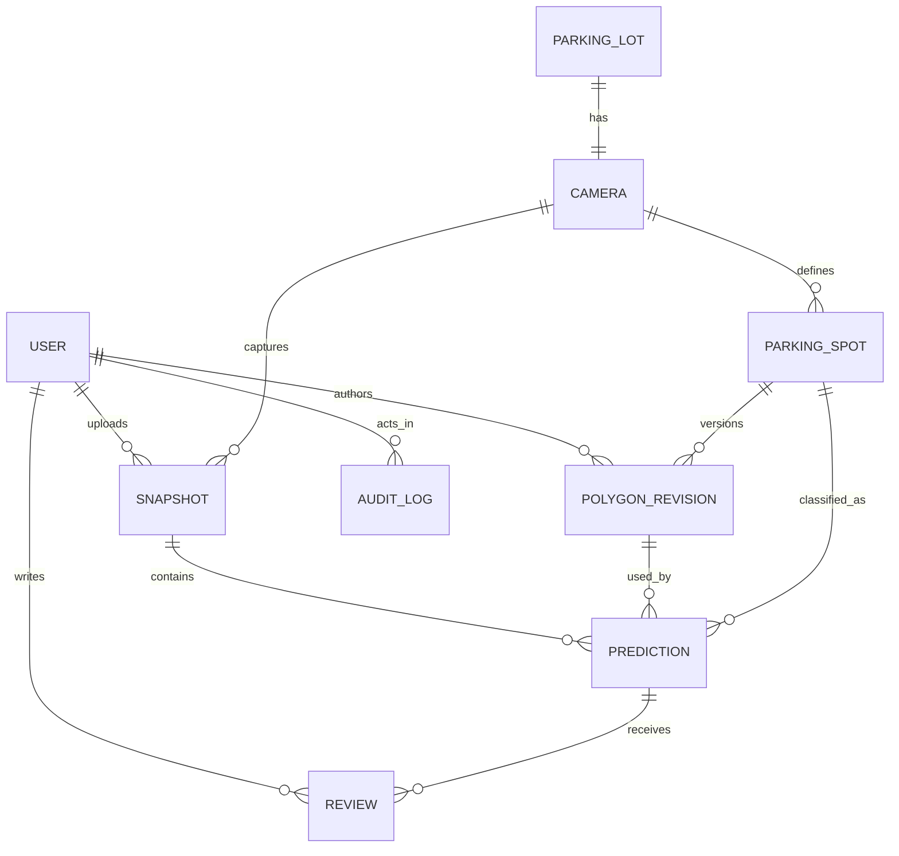

# MVP data model — migrated schema

**Status:** Schema implemented by Alembic `0002_smart_parking_schema` through `0006_review_versions` after the empty `0001_initial` baseline. This does not imply approval of the draft [SRS.md](SRS.md) or implementation of all feature routes. IDs are UUIDs, and PostgreSQL stores timestamp columns as timezone-aware `timestamptz`. Application code must supply UTC timestamps.

## Tables and relationships

| Table | Key fields and constraints | Purpose |
| --- | --- | --- |
| `users` | `id` PK; `username` unique; `password_hash`; `role` enum `admin/operator`; `is_active`; `token_version`; `created_at` | Local accounts. Password reset increments `token_version` so old JWTs fail; never store plaintext password or token. |
| `parking_lots` | `id` PK; `name`; `singleton_key` unique constrained to `true` | Exactly one operational lot row for MVP. Admin can provision it through the configuration API. |
| `cameras` | `id` PK; `parking_lot_id` FK unique; `name`; `is_active`; `reference_image_sha256`; `reference_width`; `reference_height`; `viewpoint_version` | Exactly one fixed camera for that lot. Reference metadata identifies the image used to define current polygons; no live capture integration in MVP. |
| `parking_spots` | `id` PK; `camera_id` FK; `code` unique per camera; `is_active`; `created_at` | Stable spot identity; disabling affects future snapshots only. |
| `polygon_revisions` | `id` PK; `spot_id` FK; `revision_no` unique per spot; `points` ordered JSON array; reference SHA-256, dimensions and camera viewpoint version; `created_by` FK users; `created_at` | Immutable normalized geometry and its declared reference-image identity. At least 3 distinct non-collinear vertices, finite `x/y` in `[0,1]`, no self-intersection, and four reference pixels of area are validated by configuration API before insert. Legacy revisions can have null reference metadata. |
| `snapshots` | `id` PK; `camera_id` FK; `uploaded_by` FK users; `captured_at`; `uploaded_at`; `original_key` unique; `sha256`; `mime_type`; `byte_size`; `width`; `height`; nullable nonnegative `processing_time_ms` | Accepted original image metadata. `original_key` is an opaque private storage key, never an external URL or filesystem path in API responses. Processing time is nullable for pre-migration rows. |
| `predictions` | `id` PK; `snapshot_id` FK; `spot_id` FK; `polygon_revision_id` FK; unique `(snapshot_id, spot_id)`; `prediction_status`; `confidence` nullable; `model_version` nullable; `reason_code` nullable; `inferred_at`; `review_version` | Original immutable AI result for one captured active spot. `review_version` is concurrency metadata only and advances with each appended review. The revision must belong to the same spot and camera as the snapshot. |
| `reviews` | `id` PK; `prediction_id` FK; `reviewed_by` FK users; `reviewed_status`; `note` nullable; `reviewed_at`; positive `revision_no` unique per prediction | Append-only human judgments. Highest `revision_no` determines effective status; original prediction stays intact. |
| `audit_logs` | `id` PK; nullable `actor_id` FK users; `action`; `target_type`; `target_id`; `details` nullable; `created_at` | Records application audit events. Generic target identifiers are not foreign keys because they can refer to different entity types. Do not put secrets or image bytes in `details`. |

The `predictions.camera_id` column duplicates the snapshot/spot camera ID solely to support composite foreign keys. These enforce matching prediction-to-snapshot camera, prediction-to-spot camera, and prediction-to-revision spot at the database level. All historical foreign keys use `ON DELETE RESTRICT`; disabling a spot or user preserves provenance. The application must expose no update/delete route for polygon revisions, original predictions, reviews, or audit events. SQLAlchemy validates polygon coordinates, area, distinctness and self-intersection on ORM and Core writes; direct SQL clients must follow the same contract. A database-level polygon shape constraint is not yet present.

Changing a camera reference through the Admin API requires explicit spot invalidation and increments `viewpoint_version`. Existing spot IDs and revisions remain; the spots become inactive until a new revision is saved against the current reference. The API can physically delete a camera only if it has no spots or snapshots, and can physically delete a lot only if it has no camera. The API does not store or verify reference image bytes yet; the supplied SHA-256 and dimensions must later be checked against the actual upload.

## Status and confidence constraints

`prediction_status` and `reviewed_status` use the same values: `empty`, `occupied`, `unknown`. `confidence` is numeric in `[0,1]` when a model ran and `null` when no model ran. `model_version` is nonempty when a model ran and `null` otherwise. A model-produced `unknown` may have confidence plus `reason_code=LOW_CONFIDENCE`; an inference failure or missing model produces `unknown`, null confidence/version, and `reason_code=MODEL_UNAVAILABLE` or `INFERENCE_ERROR`. An `empty` or `occupied` original prediction always has a non-null model version and confidence. The review table has no model confidence: it is explicitly human provenance.

## Derived data, not extra tables

The effective status is the latest review status or the original prediction status. Occupancy counts, `FULL`, and `STALE` derive from the latest accepted snapshot and current UTC time as defined in [SRS.md](SRS.md). They are not persisted as an `alerts` table in this MVP. A derived overlay may be cached on disk, but it is reconstructible from the original image, captured polygon revision, and effective status; it is not a ground-truth artifact.

`STALE_AFTER_SECONDS`, the model confidence threshold, the image root, and token secret are deployment configuration, not table columns. A deployed model's immutable version identifier is copied onto each model-produced prediction; a model registry table is outside MVP scope.
