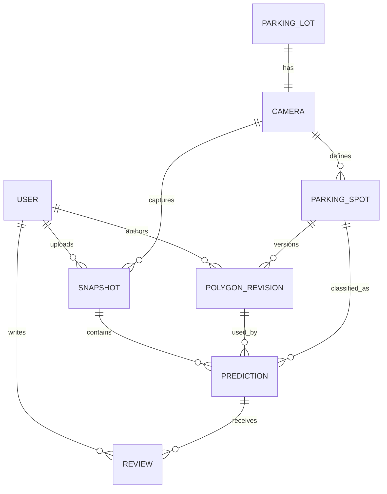

# MVP data model — proposed, not migrated

**Status:** Draft companion to [SRS.md](SRS.md) and [API_SPEC.md](API_SPEC.md). The current Alembic `0001_initial` migration is empty; none of these tables exists yet. IDs are UUIDs, timestamps are UTC `timestamptz`, and the database is PostgreSQL 16.

## Tables and relationships

| Table | Key fields and constraints | Purpose |
| --- | --- | --- |
| `users` | `id` PK; `username` unique; `password_hash`; `role` enum `admin/operator`; `is_active`; `created_at` | Local accounts. Never store plaintext password or token. |
| `parking_lots` | `id` PK; `name`; `singleton_key` unique constrained to `true` | Exactly one operational lot row for MVP. Provisioned by setup, not a public create route. |
| `cameras` | `id` PK; `parking_lot_id` FK unique; `name`; `is_active` | Exactly one fixed camera for that lot. No live capture integration in MVP. |
| `parking_spots` | `id` PK; `camera_id` FK; `code` unique per camera; `is_active`; `created_at` | Stable spot identity; disabling affects future snapshots only. |
| `polygon_revisions` | `id` PK; `spot_id` FK; `revision_no` unique per spot; `points` ordered JSON array; `created_by` FK users; `created_at` | Immutable normalized geometry. At least 3 distinct non-collinear vertices, finite `x/y` in `[0,1]`, and no self-intersection are validated by backend before insert. |
| `snapshots` | `id` PK; `camera_id` FK; `uploaded_by` FK users; `captured_at`; `uploaded_at`; `original_key` unique; `sha256`; `mime_type`; `byte_size`; `width`; `height` | Accepted original image metadata. `original_key` is an opaque private storage key, never an external URL or filesystem path in API responses. |
| `predictions` | `id` PK; `snapshot_id` FK; `spot_id` FK; `polygon_revision_id` FK; unique `(snapshot_id, spot_id)`; `prediction_status`; `confidence` nullable; `model_version` nullable; `reason_code` nullable; `inferred_at` | Original immutable result for one captured active spot. The revision must belong to the same spot and camera as the snapshot. |
| `reviews` | `id` PK; `prediction_id` FK; `reviewed_by` FK users; `reviewed_status`; `note` nullable; `reviewed_at` | Append-only human judgments. Latest `(reviewed_at, id)` determines effective status; original prediction stays intact. |

The application must enforce the cross-row camera/revision identity check transactionally; use a composite foreign key or a guarded insert so `predictions.spot_id` cannot disagree with `polygon_revisions.spot_id`, and the spot's camera cannot disagree with the snapshot camera. `polygon_revisions` and `reviews` must not be updated or deleted through the API. Set foreign-key delete behavior to restrict historical deletion; disabling a spot or user preserves provenance.

## Status and confidence constraints

`prediction_status` and `reviewed_status` use the same values: `empty`, `occupied`, `unknown`. `confidence` is numeric in `[0,1]` when a model ran and `null` when no model ran. `model_version` is nonempty when a model ran and `null` otherwise. A model-produced `unknown` may have confidence plus `reason_code=LOW_CONFIDENCE`; an inference failure or missing model produces `unknown`, null confidence/version, and `reason_code=MODEL_UNAVAILABLE` or `INFERENCE_ERROR`. An `empty` or `occupied` original prediction always has a non-null model version and confidence. The review table has no model confidence: it is explicitly human provenance.

## Derived data, not extra tables

The effective status is the latest review status or the original prediction status. Occupancy counts, `FULL`, and `STALE` derive from the latest accepted snapshot and current UTC time as defined in [SRS.md](SRS.md). They are not persisted as an `alerts` table in this MVP. A derived overlay may be cached on disk, but it is reconstructible from the original image, captured polygon revision, and effective status; it is not a ground-truth artifact.

`STALE_AFTER_SECONDS`, the model confidence threshold, the image root, and token secret are deployment configuration, not table columns. A deployed model's immutable version identifier is copied onto each model-produced prediction; a model registry table is outside MVP scope.
