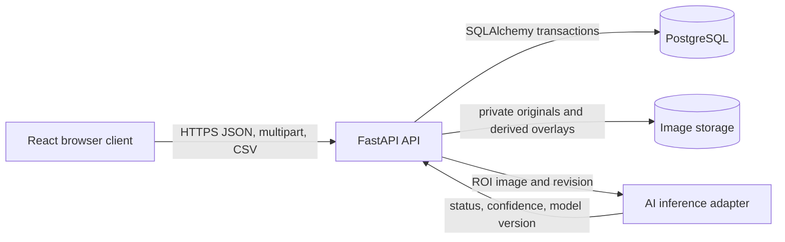

# Software Design Specification — proposed MVP

**Status:** Draft, aligned with [SRS.md](SRS.md). Design boxes below describe a target, not an implemented system. No approved SRS/WBS/handoff file was found in this checkout. Resolve [DECISIONS.md](DECISIONS.md) before implementation.

## Implemented baseline versus proposed design

| Concern | Verified repository evidence | Proposed MVP addition |
| --- | --- | --- |
| Web UI | `frontend/src/App.tsx` is a placeholder React page. | Authenticated lot view, polygon editor, upload, overlay, history/review/export. |
| HTTP API | `backend/app/main.py` exposes only `/health`; CORS currently permits GET. | Versioned `/api/v1` routes, request validation, backend RBAC, image-serving and CSV responses; extend CORS methods as required. |
| Configuration | `backend/app/config.py` separates development `.env` from production process variables. | Token signing key, private image root, upload limit, confidence threshold and staleness threshold, with startup validation. |
| Database | `backend/app/db.py` supplies lazy SQLAlchemy engine/session; Alembic `0001_initial` creates no tables. | Models in [ERD.md](ERD.md), Alembic migration, transaction boundaries. |
| AI | `ai/src/smart_parking_ai/dataset_audit.py` validates PKLot ground truth and draws audit overlays. | Separate inference adapter/model artifact with versioned output; dataset-audit XML never enters the operational API. |
| PostgreSQL | `infrastructure/compose.yaml` provides local PostgreSQL 16 with a persistent volume. | Production database provisioning/backup policy remains separate. |

## Target component boundaries

This is a **target** diagram. Only the existing React shell, FastAPI health service, SQLAlchemy utilities, and local PostgreSQL configuration are implemented. The AI inference adapter and image storage are not present. Do not use this Mermaid sketch as the final source-backed Archify diagram.

The frontend never connects directly to PostgreSQL, the image store, or model artifacts. FastAPI authenticates and authorizes every operational request, owns all validation, and keeps storage paths private. An inference adapter accepts decoded image bytes and the immutable polygon revision selected for the snapshot, crops ROIs in memory, and returns model output. It must not read PKLot XML as inference output.

## Request and data flow

1. Admin provisions users through an authenticated API after a secure bootstrap step, configures the single lot/camera, and creates spots. Each geometry edit adds a `PolygonRevision`; it does not rewrite a revision referenced by a prediction.
2. Operator uploads a JPEG/PNG to the fixed camera endpoint. The backend checks role, media type, decoded format, dimensions, size, capture time, and camera ID. It captures the set of active spot revision IDs at acceptance time.
3. The backend writes the original image to a private, non-Git image root using an opaque key. It computes a hash and stores one `Snapshot` linked to lot and camera. File/database consistency needs a staged-write/cleanup strategy; see [DECISIONS.md](DECISIONS.md).
4. Inference processes each selected polygon ROI. A model result becomes `empty` or `occupied` only when it meets the configured confidence rule. Otherwise the original result is `unknown` with an explicit reason. No model available or an inference error produces `unknown` and `confidence: null`; no ground-truth annotation is substituted.
5. One immutable `Prediction` is stored per captured spot/revision. The returned snapshot detail and derived overlay use the latest `Review`, if any, as the effective status, but retain the original result and provenance.
6. Occupancy and alert state are computed from effective statuses for the most recent accepted snapshot. A geometry edit affects only later snapshots; a review recomputes the current snapshot's counts. `STALE` is evaluated at read time from UTC capture time and `STALE_AFTER_SECONDS`.
7. History and CSV read persisted snapshot/prediction/review data through authorized API routes. Export retains both original and effective statuses.

## Authorization and integrity rules

| Operation | Admin | Operator |
| --- | --- | --- |
| Login, own identity, read lot/camera/spots/occupancy/history/image/overlay | Yes | Yes |
| Upload snapshot; review prediction; export CSV | Yes | Yes |
| Create users; create/edit/disable spots | Yes | No |

Access tokens are short lived; the backend resolves the current user and role for each request. A disabled user is denied even if a token has not expired. No public registration or default account password is permitted. The initial Admin account requires a one-time local bootstrap command with an operator-supplied secret; its exact interface remains open in [DECISIONS.md](DECISIONS.md).

Use database constraints for uniqueness and foreign keys in [ERD.md](ERD.md). Writes that combine a snapshot and predictions are transactional. The selected revision ID is stored with each prediction to prevent later polygon edits from changing historical meaning. Reviews are append-only; derive the latest by `(reviewed_at, id)` to break ties. Race handling and upload idempotency are unresolved choices.

## Geometry, image, and model boundaries

- Store normalized polygon points as an ordered JSON value on an immutable revision. Validate finite numeric coordinates in `[0,1]`, at least three distinct vertices, nonzero area, and no self-intersection. Reject a revision that loses a required spot ID relationship.
- Convert normalized points to pixel coordinates only after decoding the uploaded image. Use a documented rounding/clamping convention consistently for ROI masks and overlays. Do not alter stored original bytes.
- Store the original file privately under an opaque key; the database holds metadata, hash, dimensions, and key. Serve images via authorized API routes. Derived overlays can be generated on demand or cached; the cache is disposable and ignored by Git.
- A future model artifact must be separately versioned. Model-generated predictions require `model_version`, `inferred_at`, and `[0,1]` confidence. System-generated `unknown` records have `model_version: null`, `confidence: null`, and a reason code. PKLot ground truth is confined to offline validation/training; no XML label is an operational prediction.

## Failure behavior and checks

Use the common [API error envelope](API_SPEC.md#error-conventions). A model failure must leave an auditable snapshot with unknown per-spot results or fail atomically before acceptance; the selected strategy here is unknown per spot. Authentication failures do not disclose whether a username exists. Corrupt and oversized uploads are rejected before durable persistence. The API logs a request ID but does not log secrets or image bytes.

Before building routes, add migration/model tests, role denial tests, polygon validation tests, image validation tests, prediction/unknown/review tests, time-boundary tests for `STALE`, and CSV contract tests. The proposed requirement-to-test mapping is in [RTM.md](RTM.md). Current `scripts/check.ps1` covers the skeleton only.
